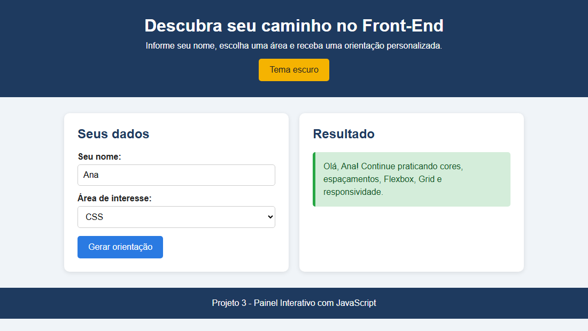

# Projeto 3 - Painel Interativo com JavaScript

## Tema

Descubra seu caminho no Front-End

A pagina pede o nome do visitante e a area de interesse (HTML, CSS ou JavaScript). Quando clica no botao, aparece uma orientacao personalizada para a area escolhida. Tambem tem um botao para trocar entre tema claro e tema escuro.

## Integrantes

- Paulo Cesar Ferreira Sá - RGM: 47308397
- Vinicius de Souza Nalini - RGM: 46889221

## Divisao das tarefas

- Paulo: estrutura do HTML, labels dos campos e JavaScript.
- Vinicius: CSS, tema escuro, media query, testes e README.

## Comandos de JavaScript utilizados

- `const` e `let`: para guardar os elementos da pagina e os valores digitados.
- `document.getElementById()`: para pegar o input do nome, o select, os botoes e o paragrafo da mensagem.
- `addEventListener("click", ...)`: para chamar as funcoes quando os botoes sao clicados.
- `.value`: para ler o nome digitado e a area escolhida.
- `.trim()`: para tirar os espacos e saber se o nome esta vazio.
- `if/else`: para verificar se o nome e a area foram preenchidos.
- `switch`: para escolher a mensagem de HTML, CSS ou JavaScript.
- template string: para colocar o nome dentro da mensagem, ex: `` `Olá, ${nome}!` ``
- `.textContent`: para mostrar a mensagem na pagina.
- funcoes: `gerarOrientacao()` e `alterarTema()`.
- `.classList.toggle()`: para colocar e tirar a classe `tema-escuro` do body.

## Como funciona

1. O usuario digita o nome e escolhe uma area no select.
2. Ao clicar em "Gerar orientação", a funcao `gerarOrientacao()` pega os valores dos campos.
3. Se o nome estiver vazio aparece uma mensagem em vermelho pedindo para preencher. Se nao escolher a area tambem aparece um aviso.
4. Se estiver tudo certo, o switch escolhe a mensagem de acordo com a area e ela aparece em verde na parte de Resultado.
5. O botao de tema chama a funcao `alterarTema()`, que usa o `classList.toggle()` para colocar ou tirar a classe `tema-escuro`. As cores do tema escuro estao no CSS.
6. Em telas menores que 600px as caixas ficam uma embaixo da outra.

## Print da pagina

